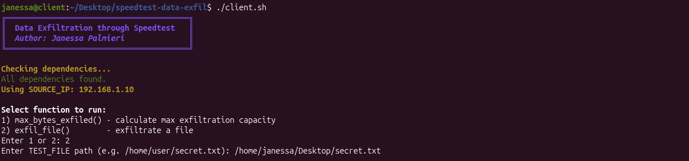
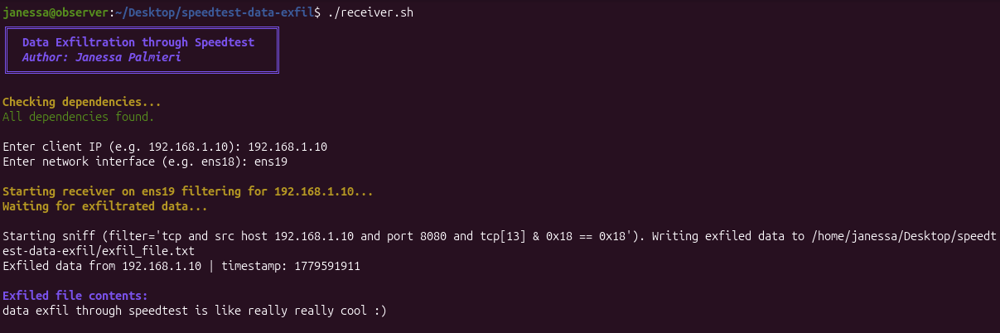
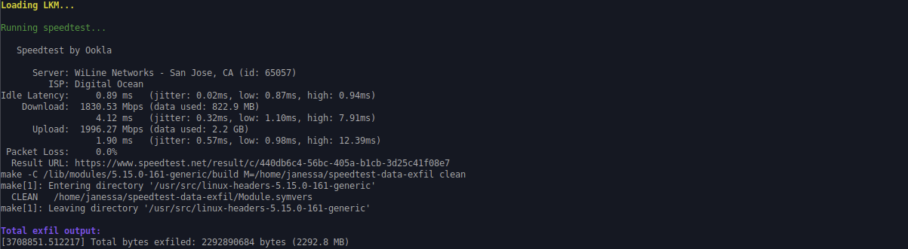

# Data Exfiltration through Ookla's Speedtest

## 📌 About
This project demonstrates data exfiltration through Ookla's Speedtest traffic. Speedtest servers using HTTP (e.g. `http://speedtest.midco.net`) or Speedtest CLI conduct tests over plaintext. TCP payloads from client → server can be overwritten without corrupting the test. This creates a unique and valuable opportunity for exfiltrating large datasets through Speedtest.

> This repository accompanies the IEEE publication *Leveraging Internet Speed Tests as a Covert Channel*, presented at the 2025 Cyber Awareness Research Symposium (CARS).

## 🔍 How it Works
Speedtest measures upload/download speeds by sending large random data chunks between the client and server. These chunks are not integrity-checked. They simply measure throughput.

During the upload speed calculation, the client sends **PSH/ACK packets** with large TCP payloads containing these random chunks. Since the server never validates the payload content, the data can be replaced with arbitrary exfiltrated data.

## ⚙️ Getting Started

`speedtest-exfil.c` is a Linux Kernel Module (LKM) using the Netfilter framework as a proof-of-concept (PoC) for exfiltrating a test file (`test-file.txt`) via Speedtest traffic.

> ⚠️ This is a PoC, not a universal exfiltration tool. Tested on the current LTS version: Ubuntu 26.04 LTS (Resolute Raccoon 🦝) with kernel version 7.0

### Primary Function
| Function | Description | 
|---|---|
| `exfil_file()` | Exfiltrates a test file from the client machine; Use an observer machine to reconstruct file with receiver.sh. |

### 📦 Prerequisites
- Two Virtual machines: 1 client & 1 observer (16 GB RAM minimum)
- Root privileges required
- Client Dependencies: `gcc`, `make`, [Speedtest CLI](https://www.speedtest.net/apps/cli)
- Observer/Receiver dependencies: `python3` + `scapy`; The observer needs to be able to see the Speedtest traffic from the client.

### 🛠️ Installation & Usage

1. **Clone the repo on both the client and receiver**
   ```sh
   git clone https://github.com/janessapalmieri/speedtest-data-exfil.git
   ```
**On the receiver machine:**

2. **CD**
   ```sh
   cd speedtest-data-exfil/
   ```

3. **Run**
   ```sh
   ./receiver.sh
   ```
   - Prompts for client IP and network interface.
   - Sniffs for exfiltrated data using SCAPY with temporal stamping.
   - Outputs the exfiltrated file contents.

**On the client machine:**

4. **CD**
   ```sh
   cd speedtest-data-exfil/
   ```

5. **Run**
   ```sh
   ./client.sh
   ```
   - This script compiles and loads `speedtest-exfil.c`, runs the Speedtest, then cleans up the build files when finished.
   - Prompts for a test file to exfiltrate.
   - Overwrites an upload speed packet with the test file.
   - Test file payload is encoded with temporal stamping so the receiver can find it: `[4-byte timestamp][2-byte file length][XOR'd file content]`

## 🚀 Usage

<p align="center">
  
  <br>
  <em>Figure 1: client.sh exfiltrating a file</em>
</p>

<p align="center">
  
  <br>
  <em>Figure 2: receiver.sh capturing exfiltrated file</em>
</p>

<p align="center">
  
  <br>
  <em>Figure 3: POC exfiltrating ~2.2 GB within a single Speedtest on a Digital Ocean Droplet</em>
</p>

## 💡 Acknowledgments

I would like to thank my mentor, Dr. Andrew Kramer of Dakota State University, for providing the original idea that inspired this project and for his continuous guidance and support throughout my career in cybersecurity.

## 📚 References

1. Palmieri, J., & Kramer, A. (2025). *Leveraging Internet Speed Tests as a Covert Channel for Data Exfiltration.* In Proceedings of the 2025 Cyber Awareness and Research Symposium (CARS) (pp. 1–7). IEEE. https://doi.org/10.1109/CARS67163.2025.11337658

2. Infosec Writeups. (n.d.). *Linux Kernel Communication Part 1: Netfilter Hooks.* Retrieved from https://infosecwriteups.com/linux-kernel-communication-part-1-netfilter-hooks-15c07a5a5c4e

3. Yaps, W. (n.d.). *List of servers available via Speedtest-CLI.* Retrieved from https://williamyaps.github.io/wlmjavascript/servercli.html

